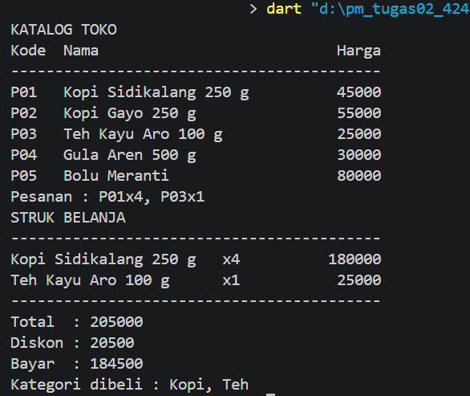
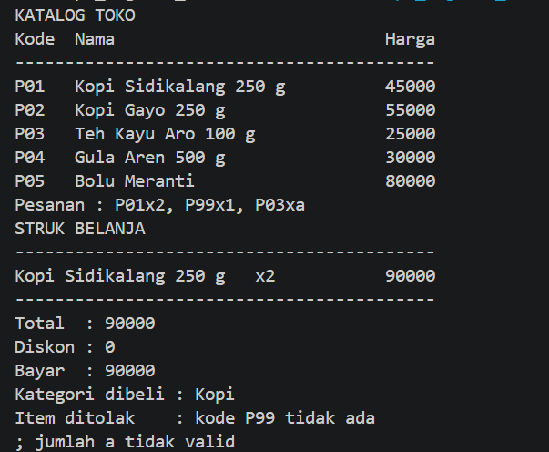

# Pemrograman Mobile - Tugas Rutin 2

Aplikasi console kasir sederhana untuk toko oleh-oleh Medan, dibuat dengan Dart.

## Identitas
- Nama       : Adinda Soleha
- NIM        : 4242550001
- Kelas      : PSIK 2024 D
- Matakuliah : Pemrograman Mobile

## Cara Menjalankan
```
dart run bin/kasir.dart
```
Format pesanan: `kode` + `x` + `jumlah`, dipisah koma. Contoh: `P01x2, P03x1`.

## Tangkapan Layar

**Skenario 1: pesanan valid** (`P01x4, P03x1`)



**Skenario 2: pesanan mengandung kode salah** (`P01x2, P99x1, P03xa`)



## Penjelasan

## Penjelasan
`var` dipakai untuk variabel yang nilainya bisa berubah, `final` untuk
variabel yang hanya diisi sekali saat program berjalan, dan `const` untuk
nilai yang sudah pasti sejak kompilasi. Di program ini saya banyak memakai
`final`, misalnya `final String input = stdin.readLineSync() ?? '';`,
karena nilai yang diisi sudah final dan tidak akan berubah setelah diisi. Saya tidak
memakai `var` dan `const` karena tidak ada nilai yang
perlu diubah dan nilainya baru diketahui saat program berjalan.

Null safety mencegah crash karena Dart mewajibkan nilai yang mungkin null
ditangani duluan. Pada `stdin.readLineSync() ?? ''`, hasilnya bisa null, jadi
`??` memberi nilai pengganti. Pada `int.tryParse(bagian[1])`, hasilnya `int?`
sehingga teks yang bukan angka menjadi null, bukan crash seperti `int.parse`.
Pada `katalog[bagian[0]]`, hasilnya selalu nullable karena kodenya bisa tidak
ada, lalu `if (produk == null)` menolak item itu sebelum `produk.nama`
dipakai. Setelah pengecekan, dart secara otomatis tau kalau variabel tersebut tidak null lagi sehingga `produk.nama`, `produk.harga` bisa diakses tanpa error.

## Pernyataan Penggunaan AI
Saya menggunakan Claude sebagai alat bantu untuk memahami konsep
(null safety, `Map`, `Set`, `map`/`fold`) dan menelusuri kesalahan pada kode.
Kode ditulis, dijalankan, dan diuji sendiri, dan saya memahami isinya. Hal yang
saya pelajari antara lain: akses `Map` selalu mengembalikan nilai nullable,
`split` menghasilkan `List`, dan perhitungan total harus berada di luar loop
agar hanya dihitung sekali.

## Hasil dart analyze

```
No issues found!
```